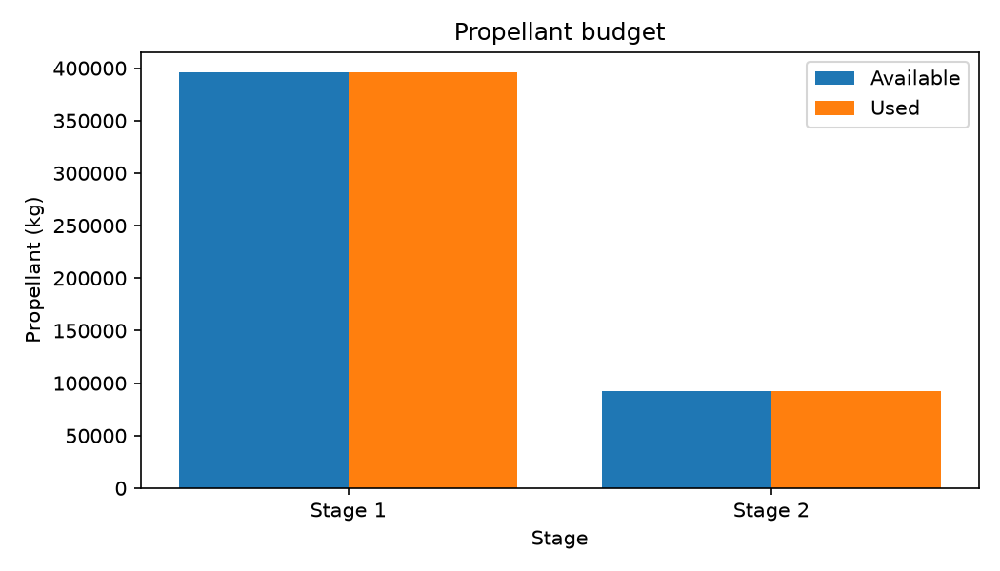
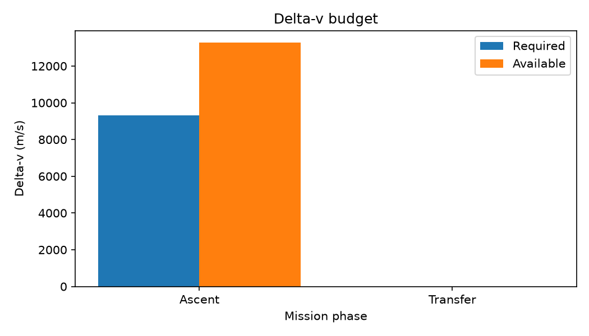

# Mission report

## Verdict
**FEASIBLE**
Feasible as requested: 3000 kg closes.
Request: 3000.0 kg to ISS using Falcon 9.

## Headline numbers
- Payload requested: 3,000 kg
- Maximum payload that closes the budget: 19,920 kg
- Stock rocket maximum payload (zero added propellant): 19,920 kg
- Shortfall: 0 kg (0%)
- Propellant margin: 0 kg (0%)
- Delta-v required vs. available: 9,300 m/s vs. 13,269.5 m/s

## Benchmark comparison

| Method | Verdict correct | Mean ceiling error | Mean shortfall error | Missing fields correct | Errors |
|---|---:|---:|---:|---:|---:|
| full_agent | 1/1 | 0.0 kg (n=1) | 0.0 kg (n=1) | 0/0 | 0 |
| llm_only | 1/1 | 1520.0 kg (n=1) | 0.0 kg (n=1) | 0/0 | 0 |
| rule_based | 1/1 | 1.3 kg (n=1) | 0.0 kg (n=1) | 0/0 | 0 |

## Burn table
| Stage | Burn / coast | Start (s) | Duration / travel (s) | Delta-v (m/s) | Propellant (kg) | Mass before (kg) | Mass after (kg) |
|---|---|---:|---:|---:|---:|---:|---:|
| 1 | Stage 1 ascent | 0 | 151.8 | 4,159.8 | 395,700 | 520,870 | 125,170 |
| 2 | Stage 2 ascent | 151.8 | 322.4 | 9,109.7 | 92,670 | 99,570 | 6,900 |

For ascent rows, duration is the modeled powered-burn time. For the transfer row, duration is the modeled coast/travel time; propellant and mass fields are not supplied by the transfer model.

## Plots

## Recommendation
**Recommendation:** Proceed with the launch. The mission is fully feasible: the requested payload of 3000.0 kg is well within the 19920 kg capacity, the required delta-v of 9300.0 m/s is covered by the available 13269.5 m/s leaving a margin of 3969.5 m/s, and there is zero propellant shortfall at 0.0 kg and 0.0%.

## Assumptions and provenance
- Request payload: 3,000 kg (PUBLISHED); source: 3,000 kg
- WARNING: Payload was derived or flagged as ambiguous; verify the arithmetic and source quantity.
- Target altitude: 400 km (PUBLISHED from request).
- Rocket variant: ESTIMATED/UNSPECIFIED; no variant was supplied.
- Published reference fields: {"leo_payload_kg": 22800}
- Stage 1 `dry_mass_kg`: 25,600 (PUBLISHED); source: Empty mass	25,600 kg / 56,423 lb
- Stage 1 `propellant_mass_kg`: 395,700 (PUBLISHED); source: Propellant mass	395,700 kg/ 872,369 lb
- Stage 1 `isp_vac_s`: 312 (PUBLISHED); source: Specific Impulse (vacuum sec)	312 sec.
- Stage 1 `isp_sl_s`: 283 (PUBLISHED); source: Specific Impulse (sea-level)	283 sec.
- Stage 1 `thrust_vac_n`: 8,227,000 (PUBLISHED); source: Thrust in vacuum	8,227 kN / 1,849,500 lbf
- Stage 1 `thrust_sl_n`: 7,607,000 (PUBLISHED); source: Thrust at sea Level	7,607 kN / 1,710,000 lbf
- Stage 2 `dry_mass_kg`: 3,900 (PUBLISHED); source: Empty mass	3,900 kg / 8,598 lb
- Stage 2 `propellant_mass_kg`: 92,670 (PUBLISHED); source: Propellant mass	92,670 kg / 204,302 lb
- Stage 2 `isp_vac_s`: 348 (PUBLISHED); source: Specific Impulse (vacuum)	348 sec
- Stage 2 `thrust_vac_n`: 981,000 (PUBLISHED); source: Thrust	981 kN / 220,500 lbf
- Model assumptions: {'losses_ms': 1500.0, 'v_target_ms': 7800.0, 's1_isp_mode': 'average', 'model': 'rocket equation minus fixed loss budget'}; payload is already in the circular parking orbit; ISS altitude and 51.6-degree inclination/plane change are not modeled.

## Experienced-amateur notes: normalized hobby context

| Hobby-rocket detail | Supplied value | Normalized value | How it relates to this run |
| --- | ---: | ---: | --- |
| Motor | E-class | E-class | Describes the separate model rocket, not a Falcon 9 stage. |
| Pad mass | 4.5 lb | 2.04 kg | Not used in the Falcon 9 payload calculation. |
| Static stability | 1.5 calibers | 1.5 calibers | Model-rocket stability measure; Falcon 9 aerodynamic/stability data are not supplied. |
| Launch-site elevation | 1,500 ft | 457.2 m | The mission model does not adjust losses for this site elevation. |
| Recovery goal | 0.5 mile | 804.7 m | Parachute recovery is outside the orbital mission model. |

The Falcon 9 model reports liftoff thrust-to-weight of **1.49** for this payload; that is not the model rocket's thrust-to-weight ratio. A hobby-rocket apogee cannot be estimated from motor class and pad mass alone. It would require a motor thrust curve and burn duration, vehicle drag/geometry, and flight conditions.

Hobby intuition remains useful for asking about stability, thrust margin, and recovery, but orbital energy and staged-mass budgets dominate this mission. None of the hobby-rocket values above are treated as Falcon 9 data.
