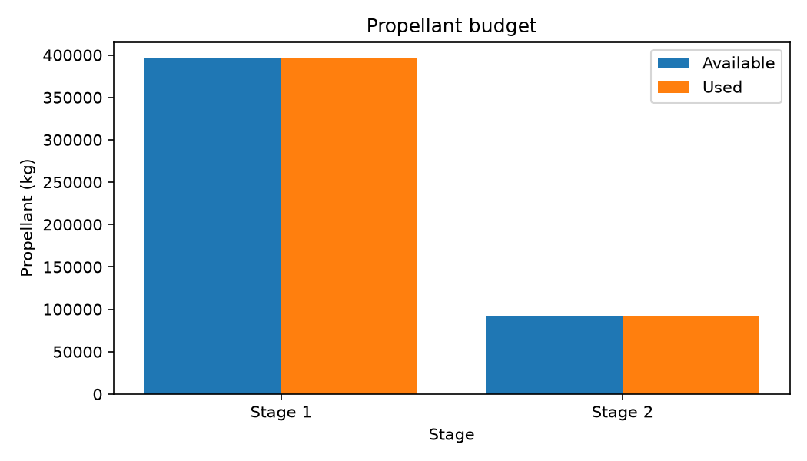
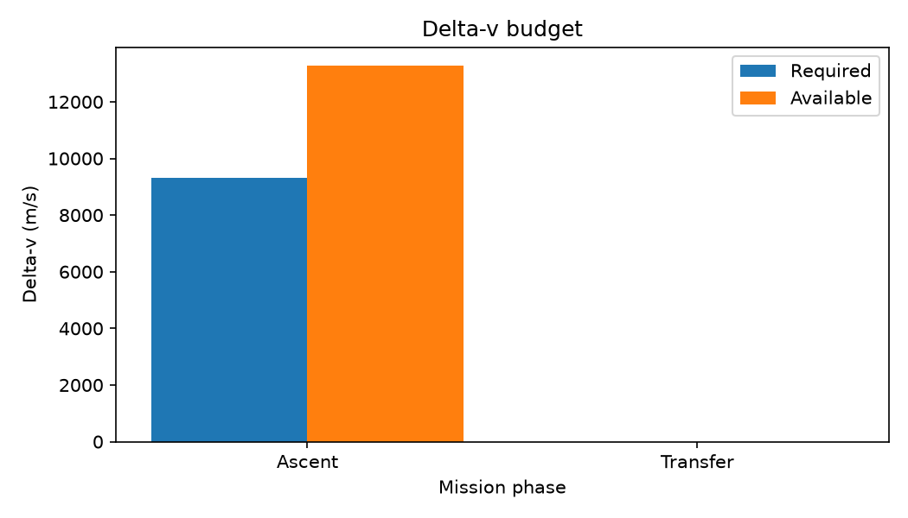

# Mission report

## Verdict
**FEASIBLE**
The mission is **FEASIBLE**: the vehicle's available delta-v of 13269.5 m/s exceeds the required 9300.0 m/s by a margin of 3969.5 m/s, and the 3000.0 kg payload is well within the 19920 kg maximum, with a shortfall of 0.0 kg.
Request: 3000.0 kg to LEO using Falcon 9.

## Headline numbers
- Payload requested: 3,000 kg
- Maximum payload that closes the budget: 19,920 kg
- Stock rocket maximum payload (zero added propellant): 19,920 kg
- Shortfall: 0 kg (0%)
- Propellant margin: 0 kg (0%)
- Delta-v required vs. available: 9,300 m/s vs. 13,269.5 m/s

## Benchmark comparison

| Method | Verdict correct | Mean ceiling error | Mean shortfall error | Missing fields correct | Errors |
|---|---:|---:|---:|---:|---:|
| full_agent | 1/1 | 0.0 kg (n=1) | 0.0 kg (n=1) | 0/0 | 0 |
| llm_only | 1/1 | 1480.0 kg (n=1) | 0.0 kg (n=1) | 0/0 | 0 |
| rule_based | 1/1 | 1.3 kg (n=1) | 0.0 kg (n=1) | 0/0 | 0 |

## Burn table
| Stage | Burn / coast | Start (s) | Duration / travel (s) | Delta-v (m/s) | Propellant (kg) | Mass before (kg) | Mass after (kg) |
|---|---|---:|---:|---:|---:|---:|---:|
| 1 | Stage 1 ascent | 0 | 151.8 | 4,159.8 | 395,700 | 520,870 | 125,170 |
| 2 | Stage 2 ascent | 151.8 | 322.4 | 9,109.7 | 92,670 | 99,570 | 6,900 |

For ascent rows, duration is the modeled powered-burn time. For the transfer row, duration is the modeled coast/travel time; propellant and mass fields are not supplied by the transfer model.

## Plots

## Recommendation
**Recommendation:** Proceed with the launch. The mission is feasible — the requested payload of 3000.0 kg falls well within the maximum capacity of 19920 kg, the available delta-v of 13269.5 m/s comfortably exceeds the required 9300.0 m/s leaving a margin of 3969.5 m/s, and there is zero propellant shortfall (0.0 kg / 0.0%), so no configuration changes are needed.

## Assumptions and provenance
- Request payload: 3,000 kg (PUBLISHED); source: 3,000 kg
- Target altitude: 200 km (PUBLISHED from request).
- Rocket variant: ESTIMATED/UNSPECIFIED; no variant was supplied.
- Published reference fields: {"leo_payload_kg": 22800}
- Stage 1 `dry_mass_kg`: 25,600 (PUBLISHED); source: Empty mass	25,600 kg / 56,423 lb
- Stage 1 `propellant_mass_kg`: 395,700 (PUBLISHED); source: Propellant mass	395,700 kg/ 872,369 lb
- Stage 1 `isp_vac_s`: 312 (PUBLISHED); source: Specific Impulse (vacuum sec)	312 sec.
- Stage 1 `isp_sl_s`: 283 (PUBLISHED); source: Specific Impulse (sea-level)	283 sec.
- Stage 1 `thrust_vac_n`: 8,227,000 (PUBLISHED); source: Thrust in vacuum	8,227 kN / 1,849,500 lbf
- Stage 1 `thrust_sl_n`: 7,607,000 (PUBLISHED); source: Thrust at sea Level	7,607 kN / 1,710,000 lbf
- Stage 2 `dry_mass_kg`: 3,900 (PUBLISHED); source: Empty mass	3,900 kg / 8,598 lb
- Stage 2 `propellant_mass_kg`: 92,670 (PUBLISHED); source: Propellant mass	92,670 kg / 204,302 lb
- Stage 2 `isp_vac_s`: 348 (PUBLISHED); source: Specific Impulse (vacuum)	348 sec
- Stage 2 `thrust_vac_n`: 981,000 (PUBLISHED); source: Thrust	981 kN / 220,500 lbf
- Model assumptions: {'losses_ms': 1500.0, 'v_target_ms': 7800.0, 's1_isp_mode': 'average', 'model': 'rocket equation minus fixed loss budget'}; payload is already in the circular parking orbit.

## Expert screening annex

### Vehicle parameters

| Stage | Dry mass (kg) | Propellant (kg) | Isp, SL (s) | Isp, vacuum (s) | Propellant / wet stage mass |
| ---: | ---: | ---: | ---: | ---: | ---: |
| 1 | 25,600 | 395,700 | 283 | 312 | 93.9% |
| 2 | 3,900 | 92,670 | not reported | 348 | 96.0% |

Requested payload: **3,000 kg to LEO**; liftoff T/W: **1.49**. The report's burn table contains per-stage mass states and delta-v. Ascent delta-v: **13,269.5 m/s available** versus **9,300.0 m/s required**; transfer delta-v: **0.0 m/s**; applied transfer reserve: **0.0 m/s (5.0%)**; residual combined margin: **3,969.5 m/s**; mission payload ceiling: **19,920 kg**.

### Sensitivity: fixed loss budget, all else held constant

| Ascent-loss budget (m/s) | Mission payload ceiling (kg) |
| ---: | ---: |
| 1,000 | 24,162 |
| 1,500 | 19,920 |
| 2,000 | 16,368 |

The pipeline applies a 5.0% reserve to modeled transfer delta-v; it does not apply the requested 5% ascent reserve. A separate sensitivity case adding 5% of the required ascent delta-v, on top of the modeled transfer reserve, gives a payload ceiling of **16,597 kg**.

### Failure modes and limitations

| Case | Treatment |
| --- | --- |
| Ascent/transfer budget shortfall | Quantitatively screened by the saved budget and margin outputs. |
| Low liftoff thrust-to-weight | Nominal check reported; engine degradation/transients not simulated. |
| Engine-out, stage separation, or guidance failure | Not modeled; no fault tree or reliability probabilities are available. |
| Destination-specific operations | orbit insertion details beyond the simplified budget are outside scope. |

The deterministic sensitivity sweep varies only the fixed ascent-loss budget while holding vehicle data and transfer reserve constant. Nominal sequential staging is assumed. These results are not uncertainty bounds or a flight-design release.
