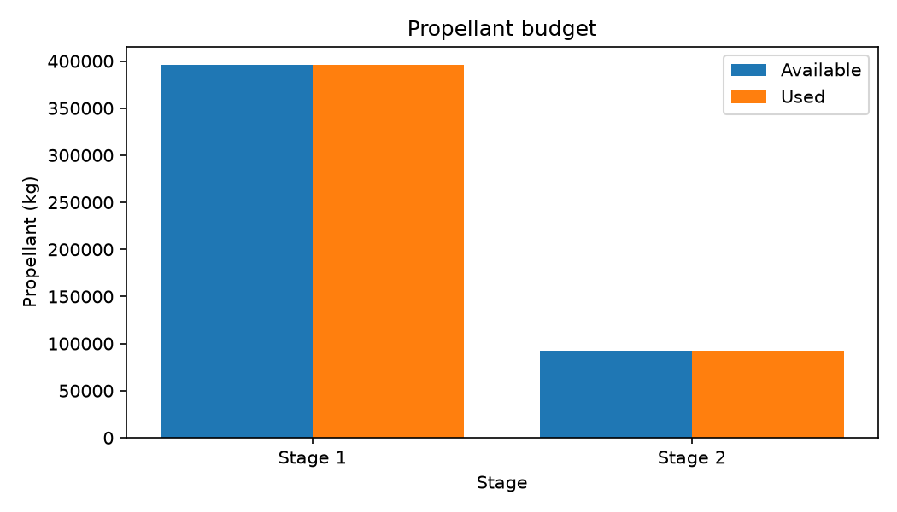
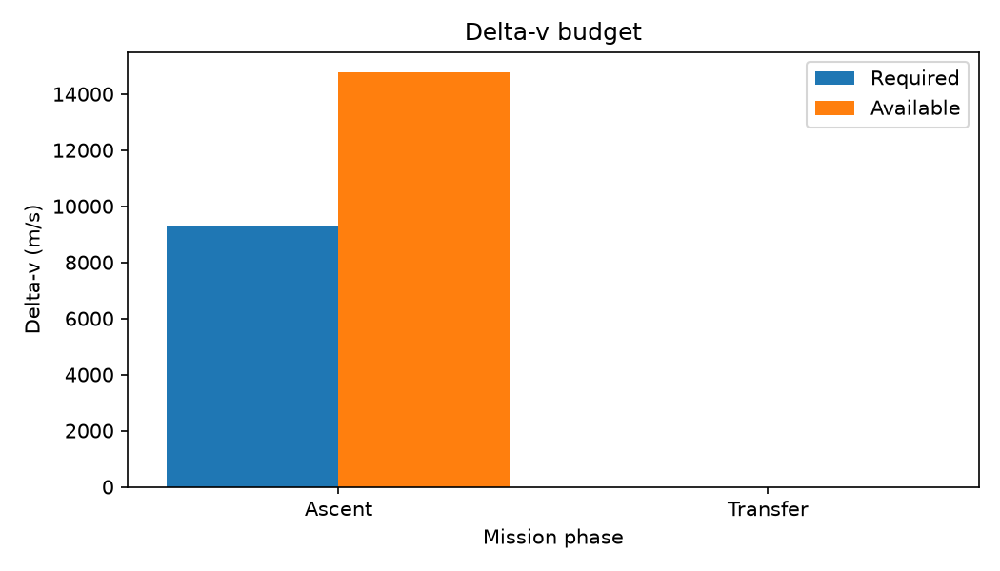

# Mission report

## Verdict
**FEASIBLE**
FEASIBLE: the request is for 500 kg on LEO using Falcon 9.
Request: 500.0 kg to LEO using Falcon 9.

## Headline numbers
- Payload requested: 500 kg
- Maximum payload that closes the budget: —
- Propellant margin: 0 kg (0%)
- Delta-v required vs. available: 9,300 m/s vs. 14,763 m/s

## Burn table
| Stage | Burn | Start (s) | Duration (s) | Delta-v (m/s) | Propellant (kg) | Mass before (kg) | Mass after (kg) |
|---|---|---:|---:|---:|---:|---:|---:|
| 1 | Stage 1 ascent | 0 | 151.8 | 4,204.6 | 395,700 | 518,370 | 122,670 |
| 2 | Stage 2 ascent | 151.8 | — | 10,558.4 | 92,670 | 97,070 | 4,400 |

## Plots

## Recommendation
The proposed mission closes the modeled ascent and transfer budgets; retain the stated vehicle and payload, subject to the listed assumptions.

> Note: deterministic template used because LLM prose was disabled or failed validation.

## Assumptions and provenance
- Request payload: 500 kg (PUBLISHED); source: 100 Kilograms
- Rocket variant: ESTIMATED/UNSPECIFIED; no variant was supplied.
- Published reference fields: {"leo_payload_kg": 22800}
- Stage 1 `dry_mass_kg`: 25,600 (PUBLISHED); source: Empty mass	25,600 kg / 56,423 lb
- Stage 1 `propellant_mass_kg`: 395,700 (PUBLISHED); source: Propellant mass	395,700 kg/ 872,369 lb
- Stage 1 `isp_vac_s`: 312 (PUBLISHED); source: Specific Impulse (vacuum sec)	312 sec.
- Stage 1 `isp_sl_s`: 283 (PUBLISHED); source: Specific Impulse (sea-level)	283 sec.
- Stage 1 `thrust_vac_n`: 8,227,000 (PUBLISHED); source: Thrust in vacuum	8,227 kN / 1,849,500 lbf
- Stage 1 `thrust_sl_n`: 7,607,000 (PUBLISHED); source: Thrust at sea Level	7,607 kN / 1,710,000 lbf
- Stage 2 `dry_mass_kg`: 3,900 (PUBLISHED); source: Empty mass	3,900 kg / 8,598 lb
- Stage 2 `propellant_mass_kg`: 92,670 (PUBLISHED); source: Propellant mass	92,670 kg / 204,302 lb
- Stage 2 `isp_vac_s`: 348 (PUBLISHED); source: Specific Impulse (vacuum)	348 sec
- Stage 2 `thrust_vac_n`: 981,000 (PUBLISHED); source: Thrust	981 kN / 220,500 lbf
- Model assumptions: {'losses_ms': 1500.0, 'v_target_ms': 7800.0, 's1_isp_mode': 'average', 'model': 'rocket equation minus fixed loss budget'}; payload is already in the circular parking orbit.
