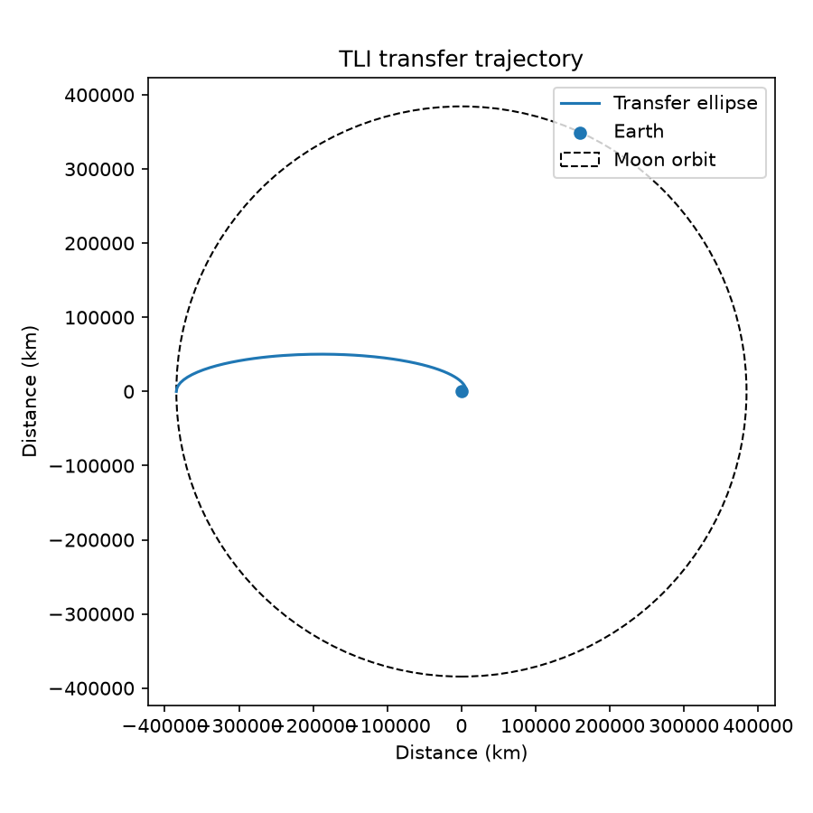
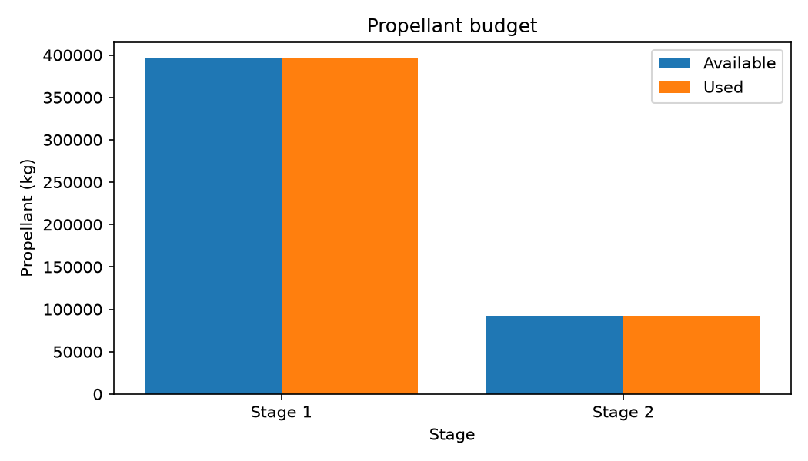
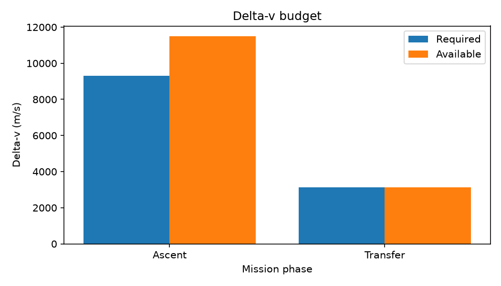

# Mission report

## Verdict
**NOT FEASIBLE**
NOT FEASIBLE: the request is for 8,000 kg on TLI using Falcon 9.
Request: 8000 kg to TLI using Falcon 9.

## Headline numbers
- Payload requested: 8,000 kg
- Maximum payload that closes the budget: 4,590 kg
- Propellant margin: -28,759.8 kg (-5.9%)
- Delta-v required vs. available: 12,587.9 m/s vs. 11,490.3 m/s

## Burn table
| Stage | Burn | Start (s) | Duration (s) | Delta-v (m/s) | Propellant (kg) | Mass before (kg) | Mass after (kg) |
|---|---|---:|---:|---:|---:|---:|---:|
| 1 | Stage 1 ascent | 0 | 151.8 | 4,073.4 | 395,700 | 525,870 | 130,170 |
| 2 | Stage 2 ascent | 151.8 | — | 7,416.9 | 92,670 | 104,570 | 11,900 |
| transfer | trans-lunar injection | 151.8 | — | 3,131.3 | — | — | — |

## Plots

## Recommendation
Reduce the payload to about 4,590 kg or increase available propellant; the requested 8,000 kg exceeds the transfer-aware ceiling.

> Note: deterministic template used because LLM prose was disabled or failed validation.

## Assumptions and provenance
- Request payload: 8,000 kg (PUBLISHED); source: 100 Kilograms
- Rocket variant: ESTIMATED/UNSPECIFIED; no variant was supplied.
- Published reference fields: {"leo_payload_kg": 22800}
- Stage 1 `dry_mass_kg`: 25,600 (PUBLISHED); source: Empty mass	25,600 kg / 56,423 lb
- Stage 1 `propellant_mass_kg`: 395,700 (PUBLISHED); source: Propellant mass	395,700 kg/ 872,369 lb
- Stage 1 `isp_vac_s`: 312 (PUBLISHED); source: Specific Impulse (vacuum sec)	312 sec.
- Stage 1 `isp_sl_s`: 283 (PUBLISHED); source: Specific Impulse (sea-level)	283 sec.
- Stage 1 `thrust_vac_n`: 8,227,000 (PUBLISHED); source: Thrust in vacuum	8,227 kN / 1,849,500 lbf
- Stage 1 `thrust_sl_n`: 7,607,000 (PUBLISHED); source: Thrust at sea Level	7,607 kN / 1,710,000 lbf
- Stage 2 `dry_mass_kg`: 3,900 (PUBLISHED); source: Empty mass	3,900 kg / 8,598 lb
- Stage 2 `propellant_mass_kg`: 92,670 (PUBLISHED); source: Propellant mass	92,670 kg / 204,302 lb
- Stage 2 `isp_vac_s`: 348 (PUBLISHED); source: Specific Impulse (vacuum)	348 sec
- Stage 2 `thrust_vac_n`: 981,000 (PUBLISHED); source: Thrust	981 kN / 220,500 lbf
- Model assumptions: {'losses_ms': 1500.0, 'v_target_ms': 7800.0, 's1_isp_mode': 'average', 'model': 'rocket equation minus fixed loss budget'}; Hohmann-to-lunar-distance estimate using Earth gravity only; TLI excludes lunar orbit insertion.
