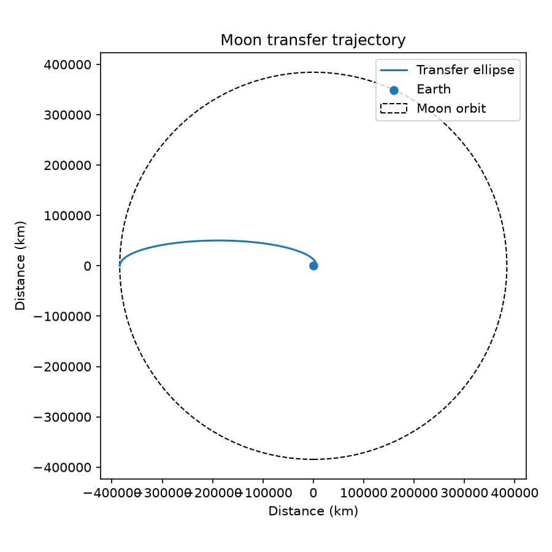

# Mission report

## Verdict
**FEASIBLE**
The mission is **feasible**, delivering a 3000.0 kg payload with 13269.5 m/s available delta-v against a 12587.9 m/s requirement, leaving a margin of 681.6 m/s and a shortfall of 0.0 kg.
Request: 3000.0 kg to Moon using Falcon 9.

## Headline numbers
- Payload requested: 3,000 kg
- Maximum payload that closes the budget: 4,590 kg
- Stock rocket maximum payload (zero added propellant): 4,590 kg
- Shortfall: 0 kg (0%)
- Propellant margin: 0 kg (0%)
- Delta-v required vs. available: 12,587.9 m/s vs. 13,269.5 m/s

## Benchmark comparison

| Method | Verdict correct | Mean ceiling error | Mean shortfall error | Missing fields correct | Errors |
|---|---:|---:|---:|---:|---:|
| full_agent | 1/1 | 0.0 kg (n=1) | 0.0 kg (n=1) | 0/0 | 0 |
| llm_only | 1/1 | 16810.0 kg (n=1) | 0.0 kg (n=1) | 0/0 | 0 |
| rule_based | 1/1 | 0.0 kg (n=1) | 0.0 kg (n=1) | 0/0 | 0 |

## Burn table
| Stage | Burn / coast | Start (s) | Duration / travel (s) | Delta-v (m/s) | Propellant (kg) | Mass before (kg) | Mass after (kg) |
|---|---|---:|---:|---:|---:|---:|---:|
| 1 | Stage 1 ascent | 0 | 151.8 | 4,159.8 | 395,700 | 520,870 | 125,170 |
| 2 | Stage 2 ascent | 151.8 | 322.4 | 9,109.7 | 92,670 | 99,570 | 6,900 |
| transfer | trans-lunar injection | 474.1 | 430,095.3 | 3,131.3 | — | — | — |

For ascent rows, duration is the modeled powered-burn time. For the transfer row, duration is the modeled coast/travel time; propellant and mass fields are not supplied by the transfer model.

## Plots

## Recommendation
**Recommendation:** Proceed with the mission as planned. The requested 3000.0 kg payload is fully feasible, well within the 4590 kg ceiling, with zero shortfall (0.0 kg / 0.0%). The available delta-v of 13269.5 m/s exceeds the required 12587.9 m/s by a margin of 681.6 m/s, and no additional propellant is needed (0.0 kg added).

## Assumptions and provenance
- Request payload: 3,000 kg (PUBLISHED); source: 3,000 kg
- WARNING: Payload was derived or flagged as ambiguous; verify the arithmetic and source quantity.
- Target altitude: 200 km (PUBLISHED from request).
- Rocket variant: ESTIMATED/UNSPECIFIED; no variant was supplied.
- Published reference fields: {"leo_payload_kg": 22800}
- Stage 1 `dry_mass_kg`: 25,600 (PUBLISHED); source: Empty mass	25,600 kg / 56,423 lb
- Stage 1 `propellant_mass_kg`: 395,700 (PUBLISHED); source: Propellant mass	395,700 kg/ 872,369 lb
- Stage 1 `isp_vac_s`: 312 (PUBLISHED); source: Specific Impulse (vacuum sec)	312 sec.
- Stage 1 `isp_sl_s`: 283 (PUBLISHED); source: Specific Impulse (sea-level)	283 sec.
- Stage 1 `thrust_vac_n`: 8,227,000 (PUBLISHED); source: Thrust in vacuum	8,227 kN / 1,849,500 lbf
- Stage 1 `thrust_sl_n`: 7,607,000 (PUBLISHED); source: Thrust at sea Level	7,607 kN / 1,710,000 lbf
- Stage 2 `dry_mass_kg`: 3,900 (PUBLISHED); source: Empty mass	3,900 kg / 8,598 lb
- Stage 2 `propellant_mass_kg`: 92,670 (PUBLISHED); source: Propellant mass	92,670 kg / 204,302 lb
- Stage 2 `isp_vac_s`: 348 (PUBLISHED); source: Specific Impulse (vacuum)	348 sec
- Stage 2 `thrust_vac_n`: 981,000 (PUBLISHED); source: Thrust	981 kN / 220,500 lbf
- Model assumptions: {'losses_ms': 1500.0, 'v_target_ms': 7800.0, 's1_isp_mode': 'average', 'model': 'rocket equation minus fixed loss budget'}; Hohmann-to-lunar-distance estimate using Earth gravity only; TLI excludes lunar orbit insertion; lunar capture is not modeled.

## Novice notes: assumptions and glossary

- **Payload assumption:** 3,000 kg, using 100 kg per person for 30 people. Cabin, life support, supplies, and other mission hardware are not included.
- **Destination assumption:** the Moon-bound request is modeled as a transfer from the default 200 km parking orbit. It does not model lunar capture, landing, or a return mission.
- **Plain-language result:** the model's payload ceiling is 4,590 kg. Compare it with the requested payload above; this simplified budget check is not proof that people could safely fly.

| Term | Plain-language meaning |
| --- | --- |
| Payload | The mass being carried, excluding rocket stages; cabin and life-support mass would also need to be counted. |
| Parking orbit | A temporary orbit around Earth before the next major burn. |
| TLI | Trans-lunar injection: a burn intended to put a spacecraft on a path toward the Moon. |
| Delta-v | A measure of how much a vehicle can change its velocity; it is a budget, not simply its final speed. |
| Apogee | The highest point of an orbit. This pipeline does not calculate an apogee for this mission. |

The model does not establish human-rating, life-support adequacy, launch licensing, lunar capture, landing, or crew return.
