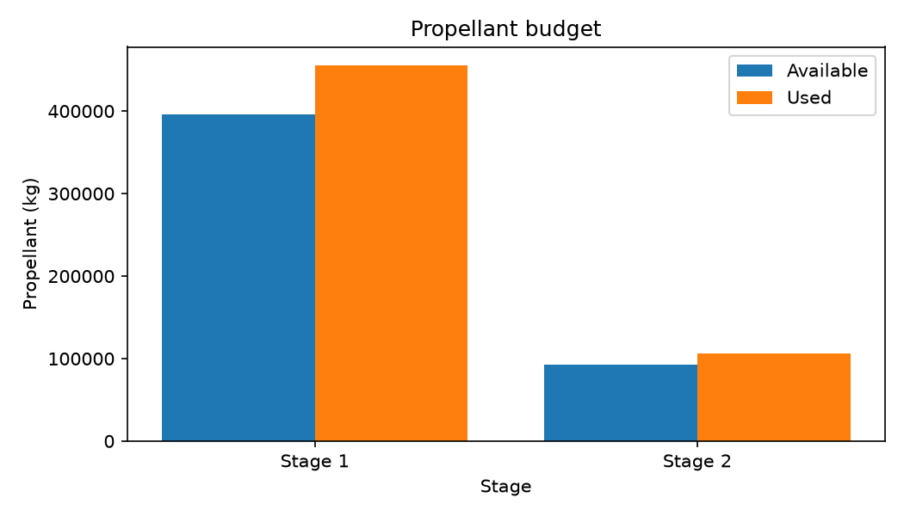
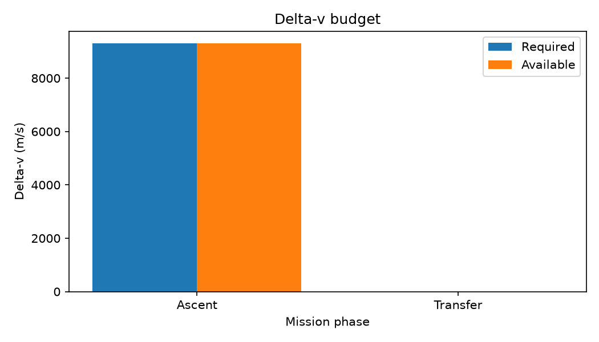

# Mission report

## Verdict
**NOT FEASIBLE AS REQUESTED**
The mission is infeasible as requested, since the 50000 kg payload demand exceeds the 23425 kg maximum by a shortfall of 26575 kg (53.1%).
Request: 50000.0 kg to LEO using Falcon 9.

## Headline numbers
- Payload requested: 50,000 kg
- Maximum payload that closes the budget: 23,425 kg
- Stock rocket maximum payload (zero added propellant): 19,920 kg
- Shortfall: 26,575 kg (53.1%)
- Propellant margin: 0 kg (0%)
- Delta-v required vs. available: 9,300 m/s vs. 9,300.1 m/s

## Burn table
| Stage | Burn | Start (s) | Duration (s) | Delta-v (m/s) | Propellant (kg) | Mass before (kg) | Mass after (kg) |
|---|---|---:|---:|---:|---:|---:|---:|
| 1 | Stage 1 ascent | 0 | 174.5 | 3,910.7 | 455,055 | 616,382 | 161,327 |
| 2 | Stage 2 ascent | 174.5 | — | 5,389.4 | 106,570 | 134,243 | 27,673 |

## Plots

## Revision history
| Change | Why | Outcome |
|---|---|---|
| {"add_propellant_kg": 59355.0, "stage": 1} | agent revision | ok |
| {"add_propellant_kg": 13900.5, "stage": 2} | agent revision | ok |
| {"payload_kg": 23425} | agent revision | ok |

## Recommendation
Reduce the payload to about 23,425 kg or increase available propellant; the requested 50,000 kg exceeds the transfer-aware ceiling.

## Assumptions and provenance
- Request payload: 50,000 kg (PUBLISHED); source: 10,000 Kilograms
- WARNING: Payload was derived or flagged as ambiguous; verify the arithmetic and source quantity.
- Rocket variant: ESTIMATED/UNSPECIFIED; no variant was supplied.
- Published reference fields: {"leo_payload_kg": 22800}
- Stage 1 `dry_mass_kg`: 25,600 (PUBLISHED); source: Empty mass	25,600 kg / 56,423 lb
- Stage 1 `propellant_mass_kg`: 395,700 (PUBLISHED); source: Propellant mass	395,700 kg/ 872,369 lb
- Stage 1 `isp_vac_s`: 312 (PUBLISHED); source: Specific Impulse (vacuum sec)	312 sec.
- Stage 1 `isp_sl_s`: 283 (PUBLISHED); source: Specific Impulse (sea-level)	283 sec.
- Stage 1 `thrust_vac_n`: 8,227,000 (PUBLISHED); source: Thrust in vacuum	8,227 kN / 1,849,500 lbf
- Stage 1 `thrust_sl_n`: 7,607,000 (PUBLISHED); source: Thrust at sea Level	7,607 kN / 1,710,000 lbf
- Stage 2 `dry_mass_kg`: 3,900 (PUBLISHED); source: Empty mass	3,900 kg / 8,598 lb
- Stage 2 `propellant_mass_kg`: 92,670 (PUBLISHED); source: Propellant mass	92,670 kg / 204,302 lb
- Stage 2 `isp_vac_s`: 348 (PUBLISHED); source: Specific Impulse (vacuum)	348 sec
- Stage 2 `thrust_vac_n`: 981,000 (PUBLISHED); source: Thrust	981 kN / 220,500 lbf
- Model assumptions: {'losses_ms': 1500.0, 'v_target_ms': 7800.0, 's1_isp_mode': 'average', 'model': 'rocket equation minus fixed loss budget'}; payload is already in the circular parking orbit.
